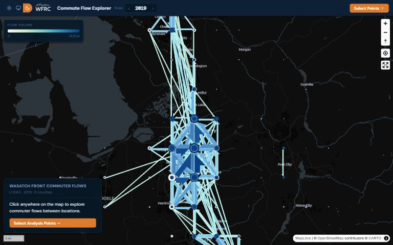

[{.tool-shot fig-alt="Screenshot of Commute Flow Explorer; opens the tool in a new tab"}](https://wfrcanalytics.github.io/APP-Commute-Explorer/){target=_blank}

[ Open the tool](https://wfrcanalytics.github.io/APP-Commute-Explorer/){.btn .btn-primary target=_blank} [ Source code](https://github.com/WFRCAnalytics/APP-Commute-Explorer){.btn .btn-outline-primary target=_blank}

## What it answers

**How do workers flow between places I choose to compare?**

*For:* Planners, researchers and anyone studying commutes around a transit stop, job center or catchment area.

## What is inside

- A region-wide flow map that breaks into detail as you zoom in.
- Place 2 to 10 points anywhere on the map and see commute flows between them, with a table of wages and industries for each origin and destination pair.
- A year slider from 2002 to 2023, covering eight Wasatch Front counties.
- Queries run in your browser, so there is no server or account.

## Where the data comes from

- US Census Bureau LEHD origin-destination employment statistics (LODES 8), filtered to the Wasatch Front counties.
- County boundaries from Census TIGER/Line files.

## About this tool

| | |
|---|---|
| Type | App |
| Status | Live |
| Last updated | June 30, 2026 (latest change to the source code) |
| Terms | WFRC's material is licensed CC BY 4.0; data from other sources keeps its own terms. See the [terms of use](../terms/index.qmd). |

## How to cite

::: {.cite}
Wasatch Front Regional Council. (2026). *Commute Flow Explorer* [Online tool]. https://wfrcanalytics.github.io/APP-Commute-Explorer/
:::

## Questions or problems?

 Email [analytics@wfrc.utah.gov](mailto:analytics@wfrc.utah.gov) or  [open an issue](https://github.com/WFRCAnalytics/APP-Commute-Explorer/issues){target=_blank} on the source repository. See also [all apps and maps](../explore/index.qmd).
