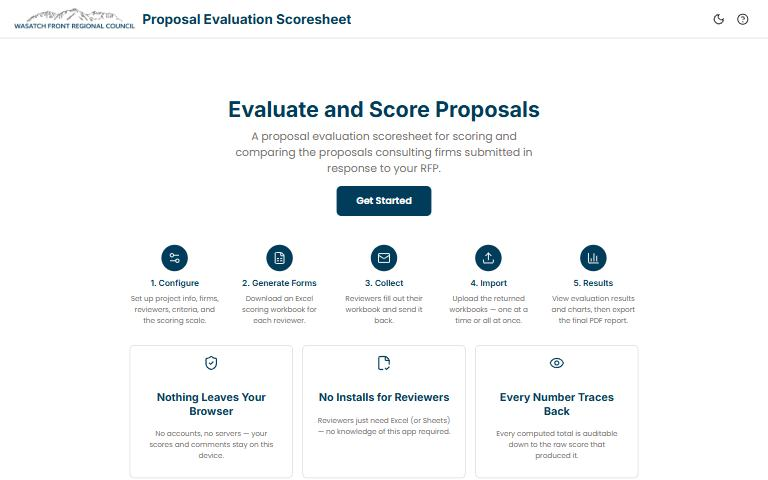

[{.tool-shot fig-alt="Screenshot of Proposal Evaluation Scoresheet; opens the tool in a new tab"}](https://wfrcanalytics.github.io/APP-Project-Scoresheet/){target=_blank}

[Open the tool](https://wfrcanalytics.github.io/APP-Project-Scoresheet/){.btn .btn-primary target=_blank} [Source code](https://github.com/WFRCAnalytics/APP-Project-Scoresheet){.btn .btn-outline-primary target=_blank}

## What it answers

**Which proposals score highest against our weighted criteria?**

*For:* WFRC staff and reviewers scoring and ranking proposals.

## What is inside

- Configurable firms, reviewers, weighted criteria and scoring scale.
- An Excel round trip for collecting reviewers' scores, and a print-quality PDF report for the official record.
- {'No server, database or accounts': 'everything runs in your browser, and the only saved file is a project file you download.'}

## Where the data comes from

- Only what you enter or load; nothing is stored on a server.

## About this tool

| | |
|---|---|
| Type | App |
| Status | Live |
| Last updated | September 18, 2026 (latest change to the source code) |
| Terms | WFRC's material is licensed CC BY 4.0; data from other sources keeps its own terms. See the [terms of use](../terms/index.qmd). |

## How to cite

::: {.cite}
Wasatch Front Regional Council. (2026). *Proposal Evaluation Scoresheet* [Online tool]. https://wfrcanalytics.github.io/APP-Project-Scoresheet/
:::

## Questions or problems?

Email [analytics@wfrc.utah.gov](mailto:analytics@wfrc.utah.gov) or [open an issue](https://github.com/WFRCAnalytics/APP-Project-Scoresheet/issues){target=_blank} on the source repository. See also [all apps and maps](../explore/index.qmd).
