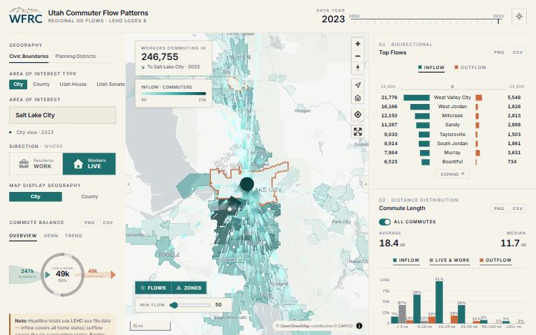

[{.tool-shot fig-alt="Screenshot of Commute Patterns Map; opens the tool in a new tab"}](https://wfrc.utah.gov/maps/regional-commuter-flows/){target=_blank}

[ Open the tool](https://wfrc.utah.gov/maps/regional-commuter-flows/){.btn .btn-primary target=_blank} [ Source code](https://github.com/WFRCAnalytics/APP-WFRC-Commute-Patterns){.btn .btn-outline-primary target=_blank}

## What it answers

**Where do residents of a city, county or legislative district work, and where do its workers live?**

*For:* Policy questions tied to named places and political districts.

## What is inside

- An arc flow map for any city, county, Utah House district or Utah Senate district, in either direction.
- Charts for commute balance, a flow diagram, means of transportation, travel time to work, commute distance and industry mix.
- Every chart exports as an image or a table.
- Data from 2002 to 2023, and light and dark display modes.

## Where the data comes from

- US Census LEHD LODES 8 for flows, industries and distances.
- American Community Survey 5-year estimates for means of transportation and travel time.

## About this tool

| | |
|---|---|
| Type | App |
| Status | Live |
| Last updated | September 22, 2026 (latest change to the source code) |
| Terms | WFRC's material is licensed CC BY 4.0; data from other sources keeps its own terms. See the [terms of use](../terms/index.qmd). |

## How to cite

::: {.cite}
Wasatch Front Regional Council. (2026). *Commute Patterns Map* [Online tool]. https://wfrc.utah.gov/maps/regional-commuter-flows/
:::

## Questions or problems?

 Email [analytics@wfrc.utah.gov](mailto:analytics@wfrc.utah.gov) or  [open an issue](https://github.com/WFRCAnalytics/APP-WFRC-Commute-Patterns/issues){target=_blank} on the source repository. See also [all apps and maps](../explore/index.qmd).
