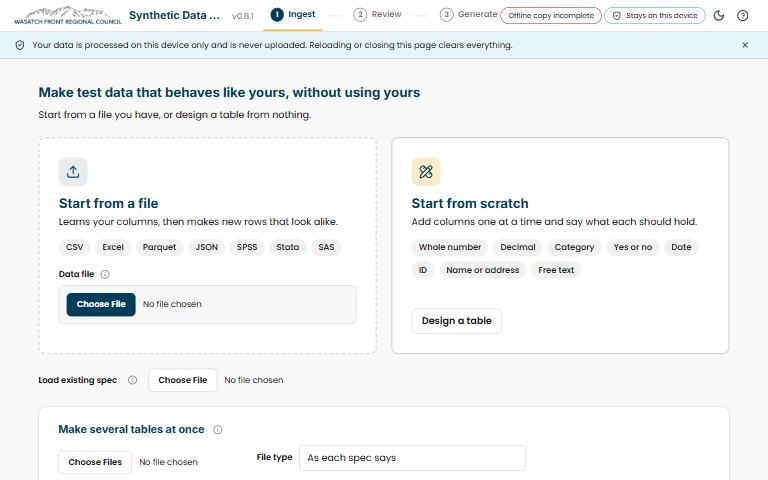

[{.tool-shot fig-alt="Screenshot of Synthetic Data Generator; opens the tool in a new tab"}](https://wfrcanalytics.github.io/APP-synthetic-data-generator/){target=_blank}

[ Open the tool](https://wfrcanalytics.github.io/APP-synthetic-data-generator/){.btn .btn-primary target=_blank} [ Source code](https://github.com/WFRCAnalytics/APP-synthetic-data-generator){.btn .btn-outline-primary target=_blank}

## What it answers

**How can I let an AI coding agent help with analysis code without handing it real survey data?**

*For:* WFRC staff and partner analysts who work with private or sensitive tables and want to use AI coding agents.

## What is inside

- Reads a CSV, Excel, Parquet, JSON, SPSS, Stata or SAS file, or lets you design a table from scratch, and shows only its structure, never row values.
- A review card for every column, where you can change types, sentinel codes, ID patterns and exclusions.
- A fake table with the same columns, row count, types, formats and summary statistics, plus a README that tells the agent the data is not real.
- A small spec file you can save and reuse; it holds summaries and settings only, never rows or personal values.
- Everything runs in your browser tab, with no uploads, accounts or analytics, and closing the page clears the real data from memory.

## Where the data comes from

- None. The tool uses only the file you choose, on your own computer. Names, emails, phone numbers and addresses in the fake file are invented from word lists.

## About this tool

| | |
|---|---|
| Type | App |
| Status | Live |
| Last updated | November 3, 2026 (latest change to the source code) |
| Terms | WFRC's material is licensed CC BY 4.0; data from other sources keeps its own terms. See the [terms of use](../terms/index.qmd). |

## How to cite

::: {.cite}
Wasatch Front Regional Council. (2026). *Synthetic Data Generator* [Online tool]. https://wfrcanalytics.github.io/APP-synthetic-data-generator/
:::

## Questions or problems?

 Email [analytics@wfrc.utah.gov](mailto:analytics@wfrc.utah.gov) or  [open an issue](https://github.com/WFRCAnalytics/APP-synthetic-data-generator/issues){target=_blank} on the source repository. See also [all apps and maps](../explore/index.qmd).
