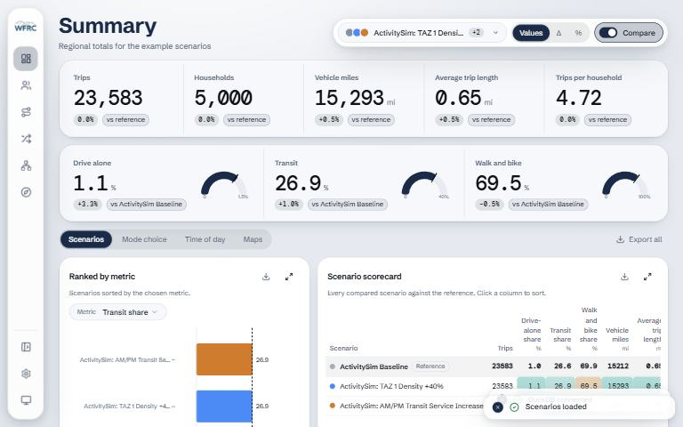

[{.tool-shot fig-alt="Screenshot of TDM Calibration Dashboard; opens the tool in a new tab"}](https://wfrcanalytics.github.io/APP-wftdm-dashboard/){target=_blank}

[ Open the tool](https://wfrcanalytics.github.io/APP-wftdm-dashboard/){.btn .btn-primary target=_blank} [ Source code](https://github.com/WFRCAnalytics/APP-wftdm-dashboard){.btn .btn-outline-primary target=_blank}

## What it answers

**How well does a model run match observed data such as traffic counts and the household travel survey?**

*For:* Analysts calibrating and validating the activity-based travel demand model (ActivitySim).

## What is inside

- Panels for Summary, Person and Household, Tour, Mode Choice, Trip, Network and a free-form Explore sandbox.
- Network panels compare screenline volumes with observed counts and show VMT by facility type and desire lines.
- Several scenarios can be loaded at once for side-by-side or overlaid comparison, with shareable deep links.
- Everything is computed in the browser; the data never leaves the user's machine.

## Where the data comes from

- Pre-computed summary files from ActivitySim model runs.
- Observed validation data, including AADT counts and the household travel survey, always available to every panel.

## About this tool

| | |
|---|---|
| Type | App |
| Status | Live |
| Last updated | October 23, 2026 (latest change to the source code) |
| Terms | WFRC's material is licensed CC BY 4.0; data from other sources keeps its own terms. See the [terms of use](../terms/index.qmd). |

## How to cite

::: {.cite}
Wasatch Front Regional Council. (2026). *TDM Calibration Dashboard* [Online tool]. https://wfrcanalytics.github.io/APP-wftdm-dashboard/
:::

## Questions or problems?

 Email [analytics@wfrc.utah.gov](mailto:analytics@wfrc.utah.gov) or  [open an issue](https://github.com/WFRCAnalytics/APP-wftdm-dashboard/issues){target=_blank} on the source repository. See also [all apps and maps](../explore/index.qmd).
