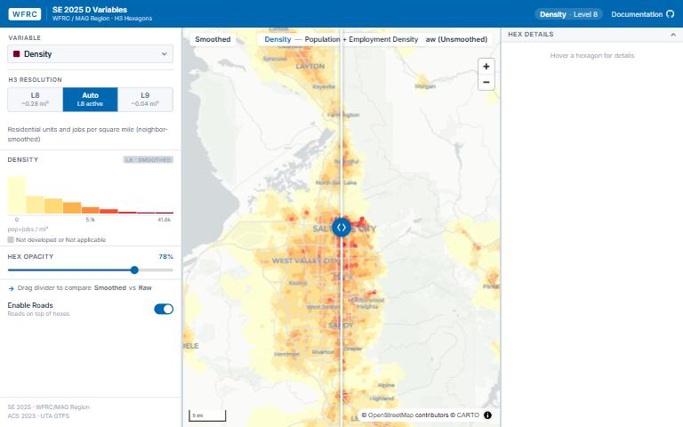

[{.tool-shot fig-alt="Screenshot of SE 2025 Urban Form D Variables; opens the tool in a new tab"}](https://wfrcanalytics.github.io/GIS_SE2025_H3/){target=_blank}

[Open the tool](https://wfrcanalytics.github.io/GIS_SE2025_H3/){.btn .btn-primary target=_blank} [Source code](https://github.com/WFRCAnalytics/GIS_SE2025_H3){.btn .btn-outline-primary target=_blank}

## What it answers

**How does the built environment vary across the region, measured with the standard "D variables" of urban form?**

*For:* Planners and analysts relating urban form to travel behavior.

## What is inside

- {'Six D variables': 'density, diversity, design, destinations, demographics and distance to transit, plus an income diversity index.'}
- A supplementary Rental Housing Attainability Index developed by Cascadia Partners with WFRC and UTA.
- Each measure at two hexagon sizes (H3 levels 8 and 9), smoothed and raw.

## Where the data comes from

- WFRC's SE 2025 socioeconomic data for the WFRC and MAG region.

## About this tool

| | |
|---|---|
| Type | Analysis |
| Status | Live |
| Last updated | September 22, 2026 (latest change to the source code) |
| Terms | WFRC's material is licensed CC BY 4.0; data from other sources keeps its own terms. See the [terms of use](../terms/index.qmd). |

## How to cite

::: {.cite}
Wasatch Front Regional Council. (2026). *SE 2025 Urban Form D Variables* [Online tool]. https://wfrcanalytics.github.io/GIS_SE2025_H3/
:::

## Questions or problems?

Email [analytics@wfrc.utah.gov](mailto:analytics@wfrc.utah.gov) or [open an issue](https://github.com/WFRCAnalytics/GIS_SE2025_H3/issues){target=_blank} on the source repository. See also [all apps and maps](../explore/index.qmd).
