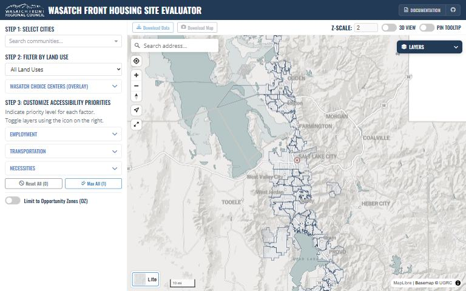

[{.tool-shot fig-alt="Screenshot of Housing ATO Calculator; opens the tool in a new tab"}](https://wfrc.utah.gov/housing-ato-calculator-map/){target=_blank}

[Open the tool](https://wfrc.utah.gov/housing-ato-calculator-map/){.btn .btn-primary target=_blank} [Source code](https://github.com/WFRCAnalytics/MAP-Housing-ATO-Calculator-Updated){.btn .btn-outline-primary target=_blank}

## What it answers

**How well does each part of the Wasatch Front score on access to jobs, transit and everyday necessities, and what changes when I weight them differently?**

*For:* Housing and land-use planners, as a conversation starter and data-informed guide.

## What is inside

- {'Eleven access factors in three groups': 'employment, transportation and necessities.'}
- You choose which factors matter to your community and weight them; the map re-scores every parcel and hexagon.
- Reference layers for Wasatch Choice Centers and Opportunity Zones, which are shown but not scored.

## Where the data comes from

- Jobs reachable by car and by transit from the WFRC Access to Opportunities data.
- Proximity to transit stops, freeway exits, bike lanes and trails, childcare, healthcare, education, grocery stores, community centers and parks.

## About this tool

| | |
|---|---|
| Type | Map |
| Status | Live |
| Last updated | September 23, 2026 (latest change to the source code) |

## How to cite

::: {.cite}
Wasatch Front Regional Council. (2026). *Housing ATO Calculator* [Online tool]. https://wfrc.utah.gov/housing-ato-calculator-map/
:::

## Questions or problems?

Email [analytics@wfrc.utah.gov](mailto:analytics@wfrc.utah.gov) or [open an issue](https://github.com/WFRCAnalytics/MAP-Housing-ATO-Calculator-Updated/issues){target=_blank} on the source repository. See also [all apps and maps](../explore/index.qmd).
