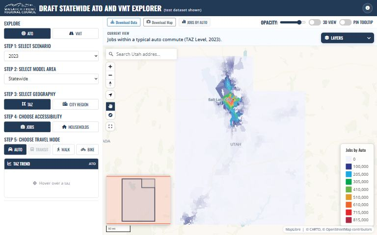

[{.tool-shot fig-alt="Screenshot of Statewide ATO and VMT Map; opens the tool in a new tab"}](https://wfrcanalytics.github.io/MAP-Statewide-ATO-VMT/){target=_blank}

[ Open the tool](https://wfrcanalytics.github.io/MAP-Statewide-ATO-VMT/){.btn .btn-primary target=_blank} [ Source code](https://github.com/WFRCAnalytics/MAP-Statewide-ATO-VMT){.btn .btn-outline-primary target=_blank}

## What it answers

**How do access to opportunities and vehicle miles traveled compare across all of Utah's travel models?**

*For:* Planners and modelers comparing model areas around the state.

## What is inside

- A web map of access to opportunities (ATO) and VMT for every model in the state.
- Simplified traffic-zone polygons, one feature per model area and zone, with values by year.

## Where the data comes from

- Raw outputs and zone shapefiles from each statewide model, processed by the numbered scripts in the repository.

## About this tool

| | |
|---|---|
| Type | Map |
| Status | Live |
| Last updated | August 14, 2026 (latest change to the source code) |
| Terms | WFRC's material is licensed CC BY 4.0; data from other sources keeps its own terms. See the [terms of use](../terms/index.qmd). |

## How to cite

::: {.cite}
Wasatch Front Regional Council. (2026). *Statewide ATO and VMT Map* [Online tool]. https://wfrcanalytics.github.io/MAP-Statewide-ATO-VMT/
:::

## Questions or problems?

 Email [analytics@wfrc.utah.gov](mailto:analytics@wfrc.utah.gov) or  [open an issue](https://github.com/WFRCAnalytics/MAP-Statewide-ATO-VMT/issues){target=_blank} on the source repository. See also [all apps and maps](../explore/index.qmd).
