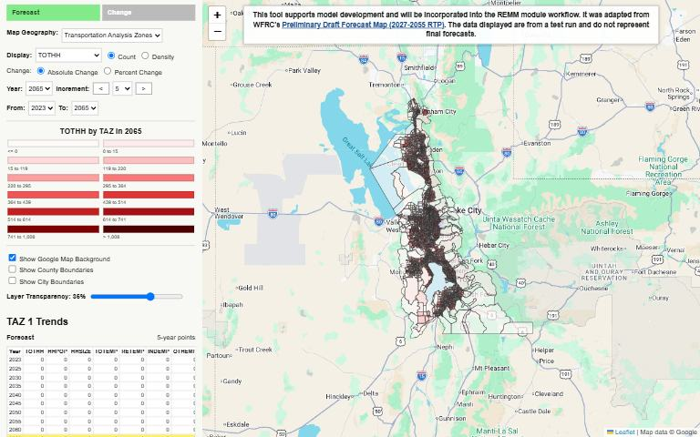

[{.tool-shot fig-alt="Screenshot of REMM Result Review Tool; opens the tool in a new tab"}](https://wfrcanalytics.github.io/REMM-Result-Review-Tool/){target=_blank}

[Open the tool](https://wfrcanalytics.github.io/REMM-Result-Review-Tool/){.btn .btn-primary target=_blank} [Source code](https://github.com/WFRCAnalytics/REMM-Result-Review-Tool){.btn .btn-outline-primary target=_blank}

## What it answers

**Do the Real-Estate Market Model's results look right as the model is being developed?**

*For:* REMM developers and reviewers.

## What is inside

- A static review map built from the model's results.
- A notebook that generates the review assets.

## Where the data comes from

- Output of the Real-Estate Market Model.

## About this tool

| | |
|---|---|
| Type | Analysis |
| Status | Live |
| Last updated | September 11, 2026 (latest change to the source code) |
| Terms | WFRC's material is licensed CC BY 4.0; data from other sources keeps its own terms. See the [terms of use](../terms/index.qmd). |

## How to cite

::: {.cite}
Wasatch Front Regional Council. (2026). *REMM Result Review Tool* [Online tool]. https://wfrcanalytics.github.io/REMM-Result-Review-Tool/
:::

## Questions or problems?

Email [analytics@wfrc.utah.gov](mailto:analytics@wfrc.utah.gov) or [open an issue](https://github.com/WFRCAnalytics/REMM-Result-Review-Tool/issues){target=_blank} on the source repository. See also [all apps and maps](../explore/index.qmd).
