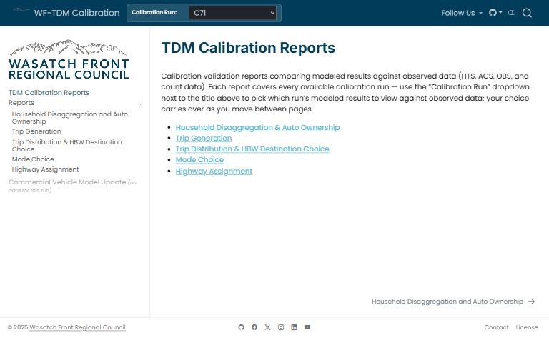

[{.tool-shot fig-alt="Screenshot of TDM Calibration Reports; opens the tool in a new tab"}](https://wfrcanalytics.github.io/WF-TDM-Calibration/){target=_blank}

[ Open the tool](https://wfrcanalytics.github.io/WF-TDM-Calibration/){.btn .btn-primary target=_blank} [ Source code](https://github.com/WFRCAnalytics/WF-TDM-Calibration){.btn .btn-outline-primary target=_blank}

## What it answers

**How was each part of the travel demand model calibrated, and how close does it come to its targets?**

*For:* Model users and reviewers who need the calibration evidence.

## What is inside

- Reports for household disaggregation and auto ownership, trip generation, trip distribution and home-based work destination choice, mode choice, highway assignment, and the commercial vehicle model update.
- Each calibration iteration is tied to a pinned model version, so results can be reproduced.

## Where the data comes from

- Calibration scripts, configurations and targets, run against a fixed version of the travel demand model.

## About this tool

| | |
|---|---|
| Type | Model |
| Status | Live |
| Last updated | October 21, 2026 (latest change to the source code) |
| Terms | WFRC's material is licensed CC BY 4.0; data from other sources keeps its own terms. See the [terms of use](../terms/index.qmd). |

## How to cite

::: {.cite}
Wasatch Front Regional Council. (2026). *TDM Calibration Reports* [Online tool]. https://wfrcanalytics.github.io/WF-TDM-Calibration/
:::

## Questions or problems?

 Email [analytics@wfrc.utah.gov](mailto:analytics@wfrc.utah.gov) or  [open an issue](https://github.com/WFRCAnalytics/WF-TDM-Calibration/issues){target=_blank} on the source repository. See also [all apps and maps](../explore/index.qmd).
