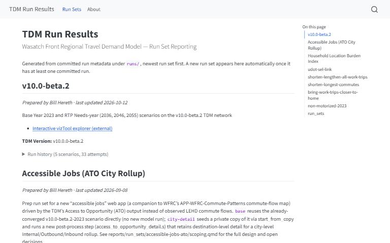

[{.tool-shot fig-alt="Screenshot of TDM Run Results; opens the tool in a new tab"}](https://wfrcanalytics.github.io/WF-TDM-Runs/){target=_blank}

[ Open the tool](https://wfrcanalytics.github.io/WF-TDM-Runs/){.btn .btn-primary target=_blank} [ Source code](https://github.com/WFRCAnalytics/WF-TDM-Runs){.btn .btn-outline-primary target=_blank}

## What it answers

**What did the travel demand model produce for each experiment, and exactly which model version and settings produced it?**

*For:* Model users and planners reviewing sensitivity tests, project alternatives and forecasting scenarios.

## What is inside

- A report for every run set, newest first, with each scenario's run history and status.
- The v10.0-beta.2 set covers a base year 2023 scenario and RTP needs-year scenarios for 2036, 2046 and 2055.
- Other run sets include accessible jobs, a household location burden index and commute-shortening sensitivity tests.
- Each run records the model version, settings and a curated set of outputs, so a result can be reproduced.

## Where the data comes from

- Cube Voyager runs of the Wasatch Front Travel Demand Model, managed by the run framework in the repository.
- Run metadata committed with each run; the report is rebuilt from it automatically.

## About this tool

| | |
|---|---|
| Type | Model |
| Status | Live |
| Last updated | October 21, 2026 (latest change to the source code) |
| Terms | WFRC's material is licensed CC BY 4.0; data from other sources keeps its own terms. See the [terms of use](../terms/index.qmd). |

## How to cite

::: {.cite}
Wasatch Front Regional Council. (2026). *TDM Run Results* [Online tool]. https://wfrcanalytics.github.io/WF-TDM-Runs/
:::

## Questions or problems?

 Email [analytics@wfrc.utah.gov](mailto:analytics@wfrc.utah.gov) or  [open an issue](https://github.com/WFRCAnalytics/WF-TDM-Runs/issues){target=_blank} on the source repository. See also [all apps and maps](../explore/index.qmd).
