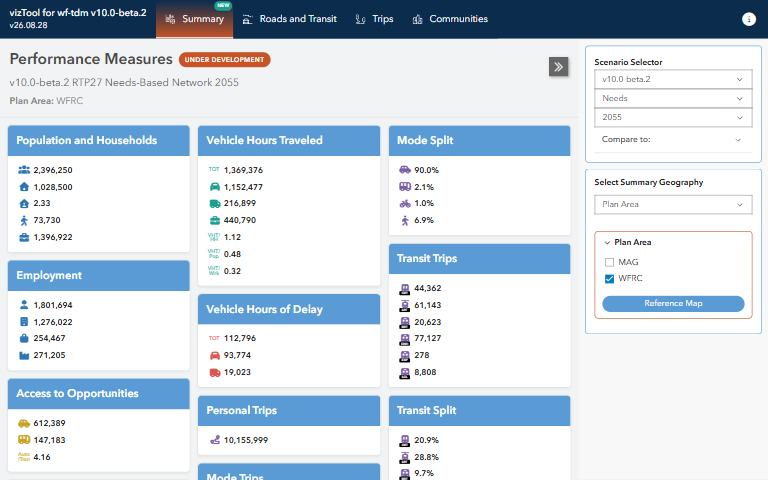

[{.tool-shot fig-alt="Screenshot of vizTool; opens the tool in a new tab"}](https://wfrc.utah.gov/viztool-latest-build/){target=_blank}

[Open the tool](https://wfrc.utah.gov/viztool-latest-build/){.btn .btn-primary target=_blank} [Source code](https://github.com/WFRCAnalytics/vizTool){.btn .btn-outline-primary target=_blank}

## What it answers

**What do the travel demand model's results look like across roads, transit, mode share and accessibility?**

*For:* Planners and analysts exploring model results and the input data behind them.

## What is inside

- Maps and charts of roadway, transit ridership, mode split and socioeconomic measures.
- Access to jobs and households, with comparisons across geographies and travel modes.
- A wiki with usage notes on the project's GitHub page.

## Where the data comes from

- Results and inputs of the Wasatch Front Travel Demand Model.

## About this tool

| | |
|---|---|
| Type | App |
| Status | Live |
| Last updated | August 27, 2026 (latest change to the source code) |

## How to cite

::: {.cite}
Wasatch Front Regional Council. (2026). *vizTool* [Online tool]. https://wfrc.utah.gov/viztool-latest-build/
:::

## Questions or problems?

Email [analytics@wfrc.utah.gov](mailto:analytics@wfrc.utah.gov) or [open an issue](https://github.com/WFRCAnalytics/vizTool/issues){target=_blank} on the source repository. See also [all apps and maps](../explore/index.qmd).
